<div align="center">


# Tappsy

**Cross-platform real-time mobile messaging client engineered with React Native, Expo SDK 54, TypeScript, and Java EE WebSockets.**
Built with a responsive tabbed UX architecture, persistent Light/Dark/System theming, and zero third-party BaaS lock-in.

<p>
  
  
  
  
  
  <a href="LICENSE">
    
  </a>
</p>

</div>

---

## System Architecture

Tappsy separates presentation, navigation, theme persistence, REST account management, and persistent bidirectional WebSocket streams into clean, modular React Context providers and custom hooks.

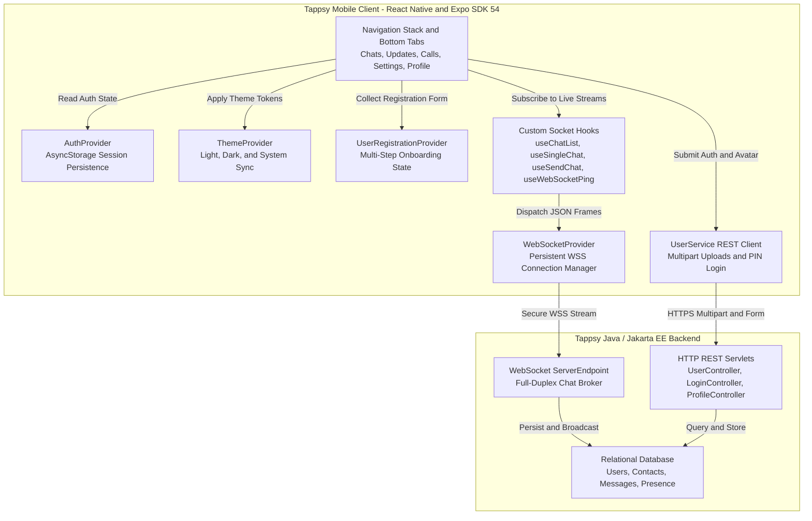

### Real-Time Messaging & Heartbeat Lifecycle

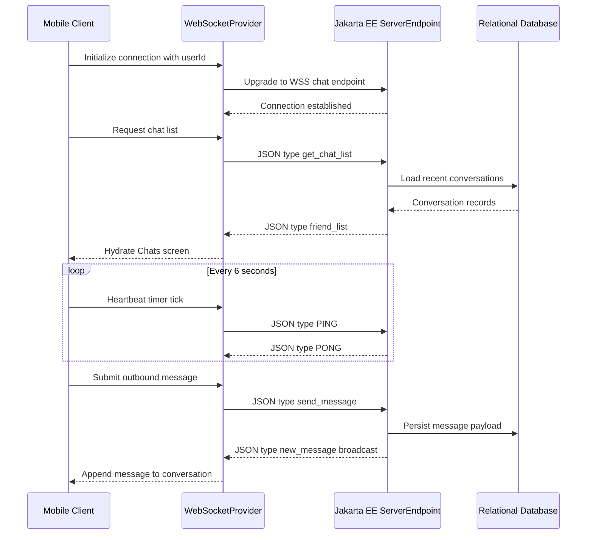

---

## Cross-Platform Interface Showcase

### iOS Captures

<table align="center">
  <tr>
    <td align="center"><b>Chats (Light)</b></td>
    <td align="center"><b>Chats (Dark)</b></td>
    <td align="center"><b>Updates &amp; Status</b></td>
    <td align="center"><b>Calls History</b></td>
  </tr>
  <tr>
    <td>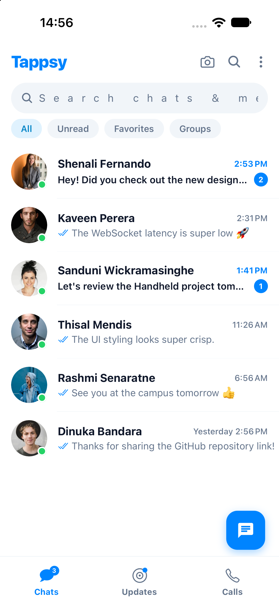</td>
    <td>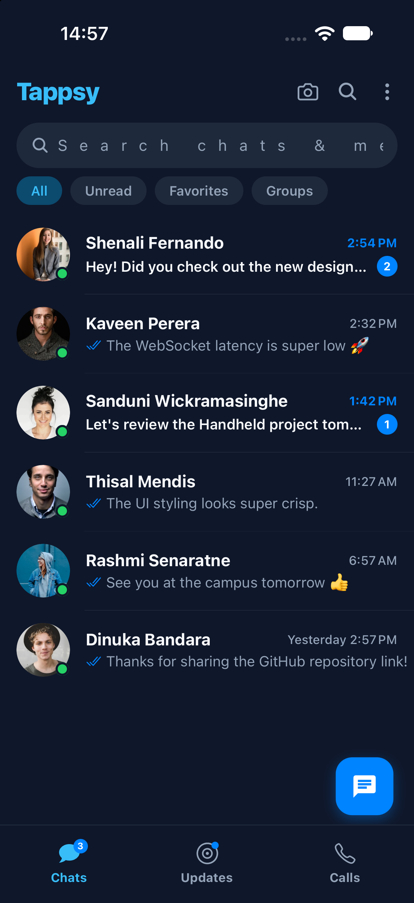</td>
    <td>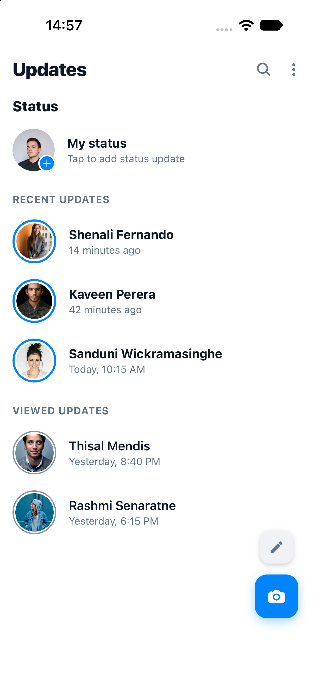</td>
    <td>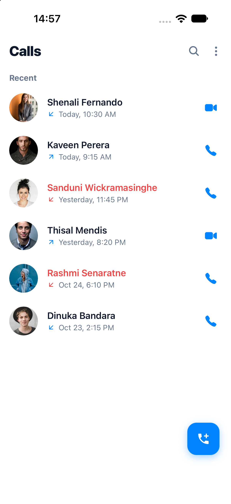</td>
  </tr>
  <tr>
    <td align="center"><b>Avatar Picker</b></td>
    <td align="center"><b>Select Contact</b></td>
    <td align="center"><b>New Contact</b></td>
    <td align="center"><b>Android Chats (Dark)</b></td>
  </tr>
  <tr>
    <td>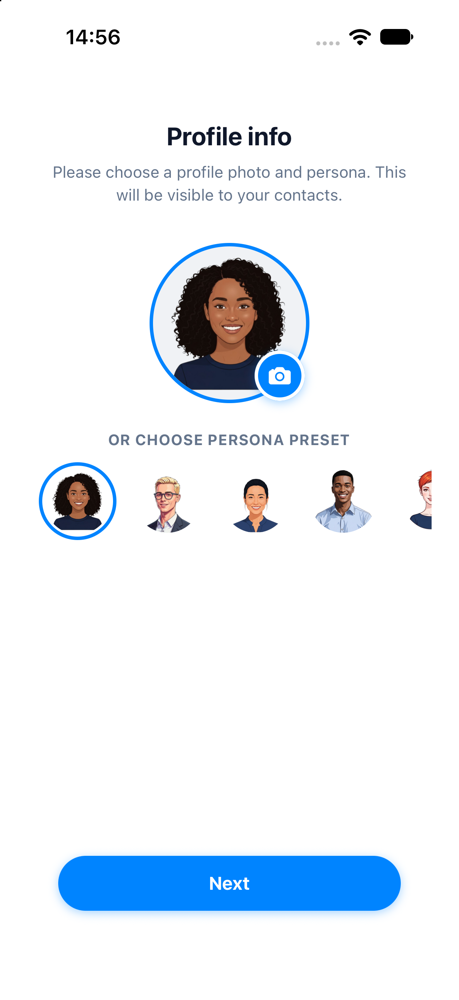</td>
    <td>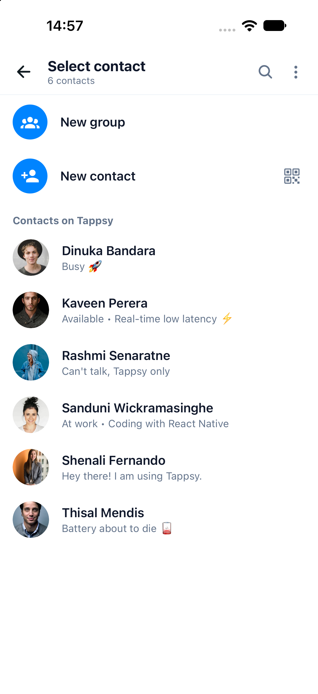</td>
    <td></td>
    <td>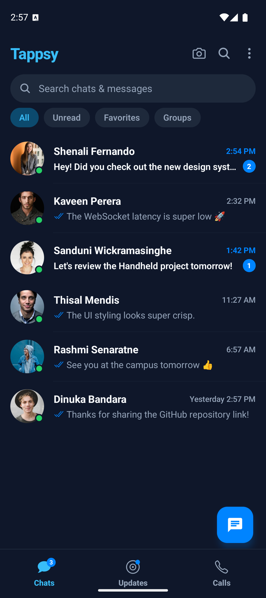</td>
  </tr>
</table>

### Android Captures

<table align="center">
  <tr>
    <td align="center"><b>Chats Hub</b></td>
    <td align="center"><b>Updates &amp; Stories</b></td>
    <td align="center"><b>Call Logs</b></td>
    <td align="center"><b>Contact Directory</b></td>
  </tr>
  <tr>
    <td>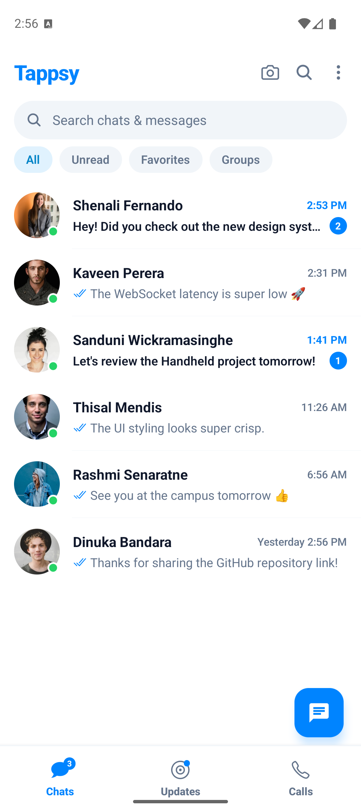</td>
    <td>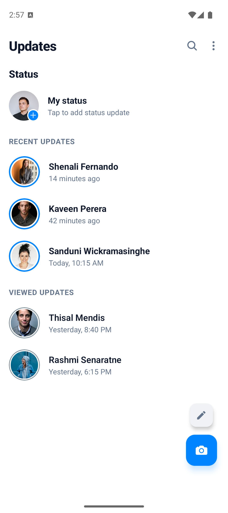</td>
    <td>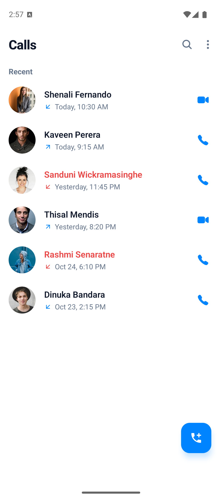</td>
    <td>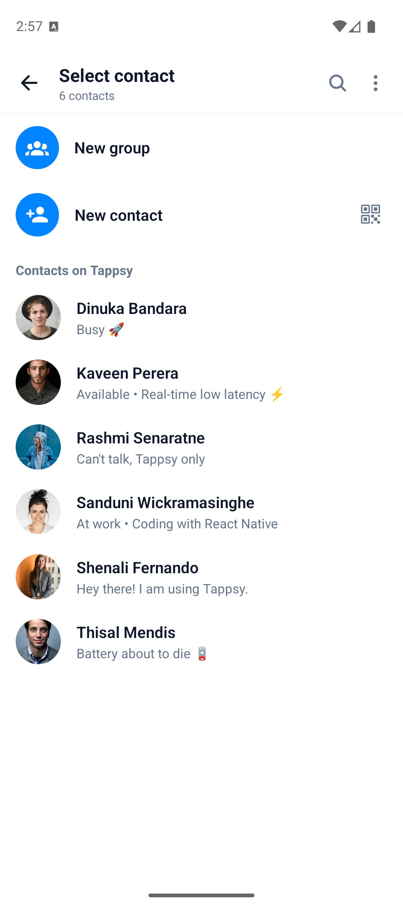</td>
  </tr>
</table>

---

## Core Engineering Highlights

- **Persistent WebSocket Engine:** Custom `WebSocketProvider` managing full-duplex `wss://` sessions paired with dedicated React hooks (`useChatList`, `useSingleChat`, `useSendChat`, `useSendNewContact`, `useUserList`, `useUserProfile`).
- **Connection Heartbeat Monitor:** Client-side `useWebSocketPing` keep-alive loop dispatching `PING`/`PONG` frames to maintain active socket health across mobile network switches.
- **Auth-Gated Navigation Stack:** React Navigation v7 native stack and bottom tab navigators dynamically switching between Onboarding (`SignUp`, `Contact`, `Avatar`, `SignIn`) and Main (`Chats`, `Updates`, `Calls`, `SingleChat`, `Profile`, `Settings`) flows via `AuthProvider`.
- **Persisted Theme Parity:** First-class Light, Dark, and System appearance synchronization backed by `AsyncStorage` and React Native `Appearance` change listeners.
- **Multipart Media & Validation Layer:** Country-aware phone validation, 4-digit PIN verification, preset avatar selection, and custom gallery uploads using `expo-image-picker` and `FormData`.
- **Offline-Resilient UI Fallbacks:** Graceful fallback demo conversations and contacts allow immediate UI exploration even before connecting a live Jakarta EE backend instance.

---

## Tech Stack

| Layer | Technologies |
| :--- | :--- |
| **Mobile Framework** | React Native `0.81.4`, Expo `SDK 54`, React `19.1.0` |
| **Language & Typing** | TypeScript `5.9.2` (strict typechecking via `npm run typecheck`) |
| **Styling & Motion** | NativeWind `v4.2` (Tailwind CSS v3), `react-native-reanimated`, `expo-linear-gradient`, `expo-blur` |
| **Navigation** | React Navigation v7 (`@react-navigation/native-stack`, `@react-navigation/bottom-tabs`) |
| **Storage & Media** | `@react-native-async-storage/async-storage`, `expo-image-picker` |
| **Backend Contract** | Java / Jakarta EE WebSockets (`@ServerEndpoint`), HTTP REST Servlets |

---

## Repository Structure

```text
Tappsy/
├── assets/                          # App icons, brand logos, and preset avatars
│   └── avatar/                      # Built-in onboarding avatar presets
├── screenshots/                     # Cross-platform iOS & Android UI captures
│   ├── android/
│   └── ios/
├── src/
│   ├── api/
│   │   └── UserService.ts           # REST endpoints for registration, login, avatar upload
│   ├── components/
│   │   ├── AnimatedLogo.tsx         # Reanimated splash logo component
│   │   ├── AuthProvider.tsx         # AsyncStorage-backed auth session context
│   │   ├── CircleShape.tsx          # Decorative geometry primitive
│   │   ├── FloatingElement.tsx      # Typed optional decorative layer
│   │   ├── GlassmorphicCard.tsx     # Translucent surface wrapper
│   │   ├── GradientBackground.tsx   # Brand gradient backdrop
│   │   └── UserContext.tsx          # Multi-step registration state provider
│   ├── screens/                     # 16 application screens (Auth, Tabs, Chat, Profile, Settings)
│   ├── socket/                      # WebSocketProvider, payload types, and custom hooks
│   ├── theme/
│   │   └── ThemeProvider.tsx        # Light / Dark / System theme engine
│   └── util/
│       ├── DateFormatter.ts         # Relative timestamp formatting
│       └── Validation.ts            # Country-aware phone, PIN, name, and image validators
├── .env.example                     # Safe environment template
├── App.tsx                          # Root providers and auth-gated navigator
├── app.json                         # Expo project manifest
├── LICENSE                          # MIT License
└── package.json                     # Dependencies and npm scripts
```

---

## Getting Started

### Prerequisites

- **Node.js** v18+ (v22 recommended) & **npm**
- **Expo Go** on a physical iOS/Android device, or Xcode iOS Simulator / Android Studio Emulator

### Installation & Local Run

1. **Clone the repository:**
   ```bash
   git clone https://github.com/theekshana-sudeepa/Tappsy.git
   cd Tappsy
   ```

2. **Install dependencies:**
   ```bash
   npm install --legacy-peer-deps
   ```
   > `--legacy-peer-deps` resolves upstream peer dependency metadata between React 19 and `react-native-country-picker-modal`.

3. **Configure environment variables:**
   Copy the template file and point it at your backend server:
   ```bash
   cp .env.example .env
   ```
   Update `.env` with your local or hosted Jakarta EE backend endpoints:
   ```env
   EXPO_PUBLIC_APP_OWNER=Tappsy
   EXPO_PUBLIC_APP_VERSION=1.0
   EXPO_PUBLIC_APP_URL=https://your-backend-domain.example.com
   EXPO_PUBLIC_WS_URL=your-backend-domain.example.com
   ```

4. **Verify TypeScript types:**
   ```bash
   npm run typecheck
   ```

5. **Start the Expo development server:**
   ```bash
   npx expo start
   ```
   Press `i` for iOS Simulator, `a` for Android Emulator, or scan the QR code with **Expo Go**.

---

## License

Distributed under the **MIT License**. See [LICENSE](LICENSE) for full details.

---

<div align="center">

Engineered by **Theekshana Sudeepa**

[](https://www.linkedin.com/in/theekshana-sudeepa/)
[](https://github.com/theekshana-sudeepa)
[](https://lexoratech.com)

</div>
