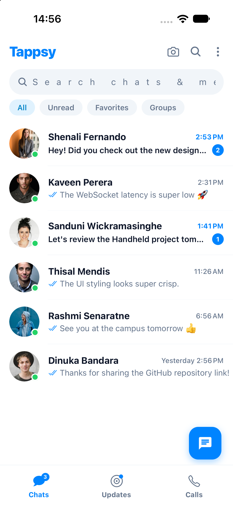
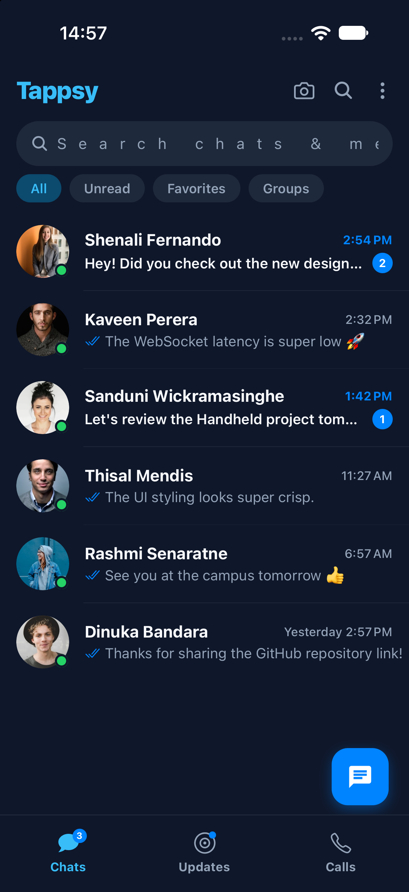
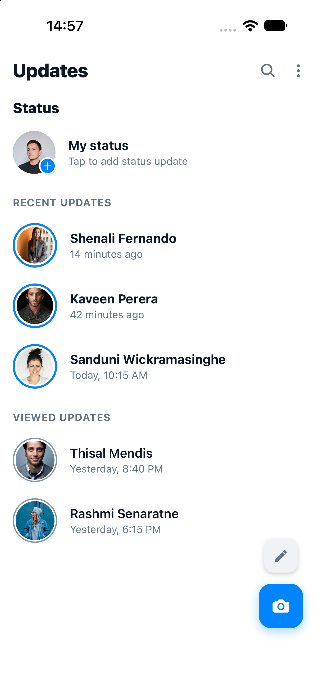
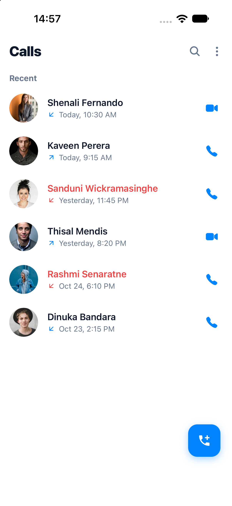
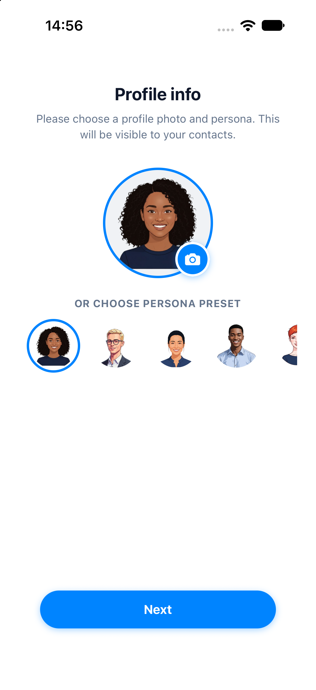
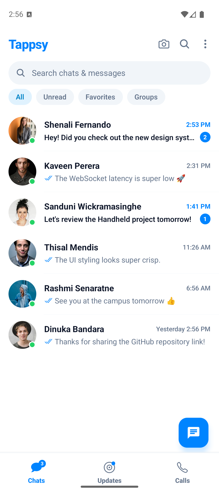
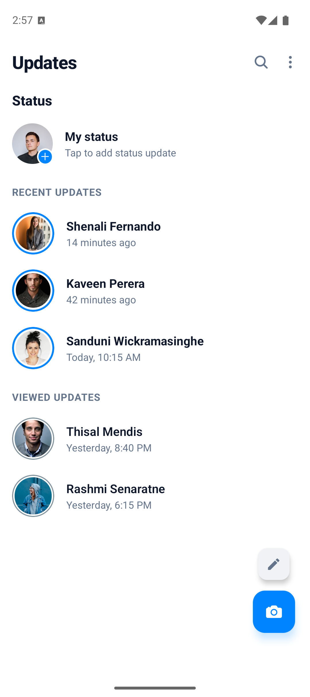
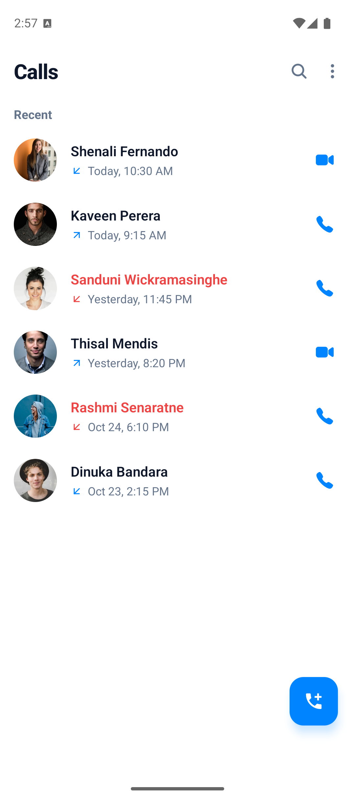

# 💬 Tappsy — Modern Real-Time Messaging App (WhatsApp Redesign)

<p align="center">
  
</p>

<p align="center">
  <b>A full-stack, real-time mobile messaging application engineered with React Native, TypeScript, and Java EE WebSockets, styled with an authentic WhatsApp design system.</b>
</p>

<p align="center">
  
  
  
  
  
  
</p>

---

## 📸 Screenshots & Cross-Platform Showcase

### 🍎 iOS (Apple iPhone 16 Pro Mockups)

<table align="center">
  <tr>
    <td align="center"><b>Chats (Light)</b></td>
    <td align="center"><b>Conversation (Light)</b></td>
    <td align="center"><b>Chats (Dark)</b></td>
    <td align="center"><b>Conversation (Dark)</b></td>
  </tr>
  <tr>
    <td></td>
    <td></td>
    <td></td>
    <td></td>
  </tr>
  <tr>
    <td align="center"><b>Status & Stories</b></td>
    <td align="center"><b>Call History</b></td>
    <td align="center"><b>User Profile</b></td>
    <td align="center"><b>Theme Settings</b></td>
  </tr>
  <tr>
    <td></td>
    <td></td>
    <td></td>
    <td></td>
  </tr>
  <tr>
    <td align="center"><b>Onboarding Flow</b></td>
    <td align="center"><b>Phone & PIN</b></td>
    <td align="center"><b>Avatar Selector</b></td>
    <td align="center"><b>New Contact</b></td>
  </tr>
  <tr>
    <td></td>
    <td></td>
    <td></td>
    <td></td>
  </tr>
</table>

### 🤖 Android (Google Pixel 9a Native Captures)

<table align="center">
  <tr>
    <td align="center"><b>Chats Hub</b></td>
    <td align="center"><b>Single Chat</b></td>
    <td align="center"><b>Status Stories</b></td>
    <td align="center"><b>HD Calls</b></td>
  </tr>
  <tr>
    <td></td>
    <td></td>
    <td></td>
    <td></td>
  </tr>
</table>

---

## 🌟 Key Features

- **⚡ Instant Real-Time Messaging:** Bidirectional communication powered by persistent WebSockets (`wss://`) for instantaneous chat delivery and receipt.
- **🟢 Live Presence & Status Tracking:** Real-time online presence detection and formatted dynamic "Last Seen" timestamps.
- **🎨 WhatsApp Architecture & Tappsy Design System:** Authentic WhatsApp tabbed layout (Chats, Updates, Calls), search filters, speech bubbles with directional tails, double blue delivery checkmarks (`✓✓`), reaction pills, and Tappsy signature Electric Blue (`#0084FF` / `#00C2FF` / `#38BDF8`).
- **🌓 Dynamic Theme Support:** First-class support for **Dark Mode** (`#0F172A` Slate), **Light Mode** (`#FFFFFF`), and **System Theme** preferences saved locally.
- **📱 Multi-Step Onboarding:** Animated multi-step registration flow featuring country-code phone selection (+94), PIN validation, and custom avatar picker.
- **🖼️ Profile & Media Handling:** Support for custom profile picture uploads via multipart form data (`expo-image-picker`) and built-in preset avatars.
- **🔔 Unread Badge Synchronization:** Real-time tracking and display of unread message counts on active conversation threads.
- **❤️ Connection Heartbeat Engine:** Client-side Ping/Pong keep-alive routines to ensure high connection reliability across mobile networks.
- **📱 Dual-Platform Native Verification:** Verified and captured across both native Apple iOS Simulator (`iPhone 18 Pro`, iOS 27 runtime on Apple Silicon) and Google Android Emulator (`Pixel 9a`, API 35).

---

## 🏗️ System Architecture

```text
┌────────────────────────────────────────────────────────┐
│              Tappsy Mobile Client (Expo)               │
│                                                        │
│  [ React Navigation v7 ]     [ Reanimated & Gestures ] │
│  [ Glassmorphic Components ] [ Auth & Theme Context ]  │
│                                                        │
│              Custom React Socket Hooks:                │
│    useChatList  •  useSingleChat  •  useSendChat       │
└───────────────────────────┬────────────────────────────┘
                            │
               ┌────────────┴────────────┐
               │  Secure Network Tunnel  │
               │ (WSS Frames & REST API) │
               └────────────┬────────────┘
                            │
┌───────────────────────────▼────────────────────────────┐
│              Tappsy Java EE Web Backend                │
│                                                        │
│  • WebSocket Endpoint: @ServerEndpoint("/chat")        │
│  • Session Pool & Broadcast Broker                     │
│  • Heartbeat Monitor (PING / PONG)                     │
│  • REST Servlets:                                      │
│      - UserController (Multipart Account Creation)     │
│      - LoginController (PIN & Contact Verification)    │
│      - ProfileController (Image Uploads)               │
│                                                        │
│                   [ Relational DB ]                    │
└────────────────────────────────────────────────────────┘
```

---

## 📂 Tech Stack

### Client:
- **Framework:** [React Native](https://reactnative.dev/) (v0.81.4) via [Expo](https://expo.dev/) (SDK 54)
- **Language:** [TypeScript](https://www.typescriptlang.org/)
- **Styling:** [NativeWind](https://www.nativewind.dev/) (Tailwind CSS v3)
- **Animations:** [React Native Reanimated](https://docs.swmansion.com/react-native-reanimated/)
- **Navigation:** [React Navigation v7](https://reactnavigation.org/) (Native Stack & Bottom Tabs)
- **Persistent Storage:** `@react-native-async-storage/async-storage`
- **Notifications & Modals:** `react-native-alert-notification`, `react-native-country-picker-modal`

### Backend (`TappsyBackEnd`):
- **Server Platform:** Java EE / Jakarta EE Web Application
- **Protocols:** WebSockets (JSR 356 `@ServerEndpoint`) & HTTP REST Servlets
- **Payload Format:** JSON over WebSocket frames
- **Storage:** Relational Database (Users, Contacts, Messages, Status)

---

## 🚀 Getting Started

### Prerequisites
- Node.js (v18 or higher recommended)
- npm or yarn
- Expo Go app on your physical device OR an iOS Simulator / Android Emulator

### Installation

1. **Clone the repository:**
   ```bash
   git clone https://github.com/ThikkaBro/Tappsy.git
   cd Tappsy
   ```

2. **Install dependencies:**
   ```bash
   npm install
   ```

3. **Configure Environment Variables:**
   Create or verify your `.env` file in the root directory:
   ```env
   EXPO_PUBLIC_APP_OWNER=Tappsy
   EXPO_PUBLIC_APP_VERSION=1.0
   EXPO_PUBLIC_APP_URL=https://your-backend-domain.com
   EXPO_PUBLIC_WS_URL=your-backend-domain.com
   ```

4. **Start the development server:**
   ```bash
   npx expo start
   ```

5. Scan the QR code with your mobile device using **Expo Go** or press `a` for Android / `i` for iOS Simulator.

---

## 📁 Project Structure

```text
Tappsy/
├── assets/                  # Logos, icons, and avatar presets
│   ├── avatar/              # Default avatar illustrations
│   └── logoBlue.png         # App branding
├── src/
│   ├── api/                 # REST service calls (UserService.ts)
│   ├── components/          # Reusable UI (GlassmorphicCard, FloatingElement, etc.)
│   ├── screens/             # App screens (SignIn, SignUp, Chats, SingleChat, etc.)
│   ├── socket/              # WebSocket provider, contracts, and custom hooks
│   ├── theme/               # ThemeProvider (Dark, Light, System)
│   └── util/                # Formatters and validation utilities
├── App.tsx                  # Root navigation & global providers
├── app.json                 # Expo configuration
└── package.json             # Dependencies and scripts
```

---

## 👨‍💻 Author

**Theekshana Sudeepa**  
- GitHub: [@ThikkaBro](https://github.com/ThikkaBro)
